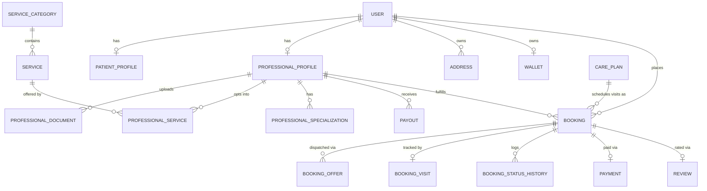

# Mendyr Backend — Architecture

Mendyr is an at-home healthcare marketplace (nurses, physiotherapists, elder/baby-care
attendants, lab technicians) connecting patients directly with verified healthcare
professionals — the same product shape as Snabbit/Urban Company, applied to home healthcare.
This document explains the codebase layout, the domain model, and the services that make up
the backend, so a new engineer can get oriented without reading every file.

Everything described here has been built, imported, migrated against a real Postgres+PostGIS
database, and smoke-tested end-to-end (signup → JWT → professional onboarding → role
checks) as part of building this scaffold. It is a real, running skeleton — not a mockup.

---

## 1. Tech stack

| Concern              | Choice                                                              |
|-----------------------|----------------------------------------------------------------------|
| API framework         | FastAPI (async)                                                     |
| Database              | PostgreSQL + PostGIS (geospatial matching), SQLAlchemy 2.0 (async ORM), Alembic (migrations) |
| Cache / queues        | Redis (rate limiting; optional), Celery (reminders, payouts — not needed for booking) |
| Auth                  | Email + password, JWT access/refresh tokens (httponly cookies for the web app) |
| Payments              | Razorpay (order + webhook + refund)                                 |
| SMS                   | MSG91 (pluggable provider interface; console provider for local dev) |
| Push                  | Firebase Cloud Messaging                                             |
| Storage               | S3-compatible object storage, presigned URLs (KYC docs, visit photos) |
| Observability         | structlog (JSON logs in prod), Sentry, Prometheus (`/metrics`)       |
| Testing               | pytest + pytest-asyncio + httpx.AsyncClient                         |
| Lint/format/types     | ruff, mypy                                                           |
| Dependency management | [uv](https://docs.astral.sh/uv/) — `uv.lock` pins every package to an exact version so `uv sync` installs identically on any machine |

---

## 2. Folder structure

```
Mendly-Backend/
├── app/
│   ├── main.py                  # FastAPI app factory: middleware, exception handlers, routers
│   │
│   ├── core/                    # Framework-agnostic cross-cutting concerns
│   │   ├── config.py            #   Settings (pydantic-settings, reads .env)
│   │   ├── constants.py         #   Every domain enum (mirrors Postgres native ENUM types)
│   │   ├── security.py          #   Password hashing, JWT issue/verify
│   │   ├── exceptions.py        #   AppError hierarchy + FastAPI exception handlers
│   │   ├── logging.py           #   structlog configuration
│   │   ├── middleware.py        #   Request-id + access-log middleware
│   │   ├── permissions.py       #   Role-based route guards (require_patient, require_admin, ...)
│   │   └── rate_limit.py        #   slowapi limiter (Redis-backed)
│   │
│   ├── db/                      # Database plumbing (no business logic)
│   │   ├── base_class.py        #   Declarative Base + UUID/Timestamp/SoftDelete mixins
│   │   ├── session.py           #   Async engine/sessionmaker + get_db() FastAPI dependency
│   │   ├── redis.py             #   Shared async Redis client
│   │   └── types.py             #   pg_enum() helper — see "Native enums" below
│   │
│   ├── models/                  # SQLAlchemy ORM models = the schema, one file per bounded area
│   │   ├── user.py              #   User, OTPVerification, DeviceToken
│   │   ├── patient.py           #   PatientProfile (medical context for care)
│   │   ├── professional.py      #   ProfessionalProfile, KYC docs, specializations, availability
│   │   ├── address.py           #   Geocoded patient addresses (PostGIS Geography point)
│   │   ├── service.py           #   ServiceCategory, Service, ProfessionalService (catalogue)
│   │   ├── booking.py           #   CarePlan, Booking, BookingOffer, BookingVisit, status history
│   │   ├── payment.py           #   Payment, Payout
│   │   ├── wallet.py            #   Wallet, WalletTransaction, Coupon, CouponRedemption
│   │   ├── review.py            #   Review (post-visit rating)
│   │   ├── notification.py      #   Notification (push/SMS/email/in-app log)
│   │   ├── support.py           #   SupportTicket, SupportTicketMessage
│   │   └── audit.py              #   AuditLog (admin/ops actions)
│   │
│   ├── schemas/                 # Pydantic request/response DTOs — never expose ORM models directly
│   │
│   ├── repositories/            # Thin async query layer between services and the DB
│   │   ├── base.py              #   Generic CRUD (get/list/add/delete) via a TypeVar model
│   │   ├── user_repo.py
│   │   ├── professional_repo.py #   Includes the PostGIS nearest-professional geo query
│   │   ├── booking_repo.py      #   Booking + BookingOffer queries
│   │   └── wallet_repo.py       #   Includes row-locked reads for safe balance mutation
│   │
│   ├── services/                # Business logic — see §4, "Services", below
│   │
│   ├── integrations/             # Outbound calls to third parties, isolated behind small interfaces
│   │   ├── razorpay_client.py   #   Order create, signature verify, refund
│   │   ├── s3_client.py         #   Presigned upload/download URLs
│   │   ├── sms/                 #   Provider-swappable: console (dev) | msg91 (prod)
│   │   ├── push/fcm.py          #   Firebase push
│   │   └── maps/google_maps.py  #   Geocoding + ETA
│   │
│   ├── api/v1/
│   │   ├── deps.py              #   get_current_user, pagination
│   │   ├── api.py               #   Aggregates every endpoint router
│   │   └── endpoints/           #   One file per resource (auth, bookings, offers, visits, ...)
│   │
│   └── workers/                 # Celery — background/scheduled jobs
│       ├── celery_app.py        #   App + beat schedule
│       └── tasks/                #   payouts, reminders, notifications
│
├── alembic/                     # DB migrations (hand-verified against a real Postgres+PostGIS)
│   ├── env.py
│   └── versions/0001_..._initial_schema.py
│
├── scripts/seed.py               # Idempotent reference-data seeding (categories, services, specializations)
├── tests/                        # pytest suite (unit + integration), see §7
├── docker-compose.yml            # postgres(+postgis) + redis + api + celery worker + celery beat
├── Dockerfile
├── Makefile                      # make dev / migrate / test / up / ...
├── pyproject.toml                 # project + dependency declarations (>= floors)
├── uv.lock                        # exact resolved versions — commit this, everyone gets the same install
└── .env.example
```

**Why this layering?** Each layer only knows about the one below it:
`endpoints → services → repositories → models`. Endpoints never touch the ORM or write SQL
directly; services never know about HTTP (`Request`, status codes); repositories never contain
business rules (discounts, state machines, matching logic). This makes services independently
unit-testable and keeps the HTTP layer thin enough to skim in one pass.

### Native enums (`app/db/types.py`)

Every domain enum in `app/core/constants.py` is a `StrEnum` (e.g. `UserRole.PATIENT = "patient"`).
SQLAlchemy's `Enum` type stores the Python member's `.name` in Postgres by default, which would
silently write `'PATIENT'` instead of `'patient'` — surprising for anyone querying the database
directly, and inconsistent with the constants file. `pg_enum(EnumClass, "pg_type_name")` fixes
this with `values_callable`, so every native Postgres ENUM's labels are lowercase and match the
`StrEnum` values exactly. Confirmed with `enum_range(NULL::user_role)` → `{patient,professional,admin,ops}`.

---

## 3. Domain model (30 tables)



Full list of tables (see `app/models/`): `users`, `otp_verifications`, `device_tokens`,
`patient_profiles`, `professional_profiles`, `professional_documents`, `specializations`,
`professional_specializations`, `professional_availability_slots`, `addresses`,
`service_categories`, `services`, `professional_services`, `care_plans`, `bookings`,
`booking_offers`, `booking_status_history`, `booking_visits`, `visit_tracking_pings`,
`payments`, `payouts`, `wallets`, `wallet_transactions`, `coupons`, `coupon_redemptions`,
`reviews`, `notifications`, `support_tickets`, `support_ticket_messages`, `audit_logs`.

### Key design decisions

- **Price snapshotting.** A `Booking` stores `base_price`, `platform_fee`, `tax_amount`,
  `commission_pct`, etc. as columns at creation time, not references to live catalogue rows —
  so a later price change never rewrites the cost of an already-placed booking.
- **Geospatial matching.** `addresses.location`, `professional_profiles.current_location` and
  `bookings.service_location` are PostGIS `Geography(POINT, 4326)` columns with explicit GiST
  indexes, queried via `ST_DWithin`/`ST_Distance` in `professional_repo.find_nearby_candidates`.
- **Append-only audit trail.** `booking_status_history` and `wallet_transactions` are
  insert-only ledgers; balances/statuses are derived, not the source of truth for history.
- **Care plans vs. one-time bookings.** A `CarePlan` (e.g. "7-day post-surgery care, twice
  daily") is a schedule; each visit is still its own `Booking` row, dispatched independently —
  a patient can have a different nurse show up on different days of the same plan.

---

## 4. Services (`app/services/`) — what each one owns

| Service | Responsibility |
|---|---|
| `auth_service.py` | Email + password register/login; issues rotating JWT access/refresh tokens. |
| `user_service.py` | Profile read/update, device-token registration for push. |
| `address_service.py` | Patient address book; converts lat/lng ↔ PostGIS `Geography` points. |
| `professional_service.py` | Onboarding, KYC document records, availability slots/status, ops KYC review. |
| `catalog_service.py` | Read-only service categories/services for the app home screen. |
| `pricing_service.py` | **Single source of truth for fare math** — coupon discount → platform commission → GST → total. Pure/stateless so it's trivially unit-tested (see `tests/unit/test_pricing_service.py`). |
| `booking_service.py` | **The core "connect patient to professional" logic** — booking state machine (`VALID_TRANSITIONS`), quoting, creation, accept/release, cancellation, and the patient's/professional's views of a booking. See §5. |
| `visit_service.py` | Check-in (start, optionally geofenced) → check-out (complete, with notes). |
| `geocoding_service.py` | Pincode/city → coordinates and device location → address fields (OpenStreetMap Nominatim), so nobody has to know their latitude. |
| `payment_service.py` | Razorpay order creation, signature verification, webhook handling (idempotent), refunds. Not used by the prototype's pay-after-visit web flow. |
| `payout_service.py` | Aggregates completed visits into a weekly payout per professional. |
| `wallet_service.py` | Credit/debit with row-level locking (`SELECT ... FOR UPDATE`) to avoid races on concurrent balance changes. |
| `review_service.py` | Post-visit rating; updates the professional's rolling average atomically. |
| `notification_service.py` | Fan-out: writes an in-app `Notification` row + pushes to all registered devices. |
| `support_service.py` | Support tickets and threaded messages. |
| `storage_service.py` | Presigned S3 upload/download URLs for KYC docs and visit photos. |

Each service takes an `AsyncSession` in its constructor and is instantiated per-request in the
endpoint layer — no service is a singleton, so there's no shared mutable state to reason about.

---

## 5. Matching — how a patient gets connected to a professional

The prototype uses an **open-request board** (`app/services/booking_service.py`), chosen
because it needs no background worker — FastAPI Cloud only runs the web process:

1. **Publish.** `POST /bookings` creates the booking as `SEARCHING` straight away (payment
   is collected after the visit, outside the app, for now).
2. **Who sees it.** `GET /bookings/professional/requests` lists, for the calling
   professional, every `SEARCHING` booking that hasn't started yet where:
   - the service is one their profession does and they've opted into,
   - the address is inside **their own** travel radius (`base_service_radius_km`, around
     the service-area point they set at onboarding — PostGIS `ST_DWithin`),
   - the start time falls inside one of their **weekly timings** (`MARKET_TIMEZONE`
     wall-clock; no timings set = available any time),
   - they're approved and have "accepting requests" switched on.
   The same rules, from the other side, power `GET /professionals/nearby` ("N
   professionals available near you"). Both live in the repositories as SQL —
   `BookingRepository.open_requests_query` and `ProfessionalRepository.find_nearby_candidates`
   — and must be kept in step.
3. **First accept wins.** `POST /bookings/{id}/accept` row-locks the booking
   (`SELECT ... FOR UPDATE`), re-checks the rules, assigns it (`ASSIGNED`). A second accept
   gets a 409.
4. **Can't make it.** `POST /bookings/{id}/release` hands an accepted, not-yet-started
   booking back to the board (`SEARCHING`).
5. **Visit.** `check-in` → `IN_PROGRESS` (allowed from 2 hours before the start; geofenced
   only when `VISIT_GEOFENCE_ENABLED`), `check-out` → `COMPLETED` with visit notes.

Before acceptance a professional sees only the area, the time, their earning and the
patient's notes; the street address and the patient's name/phone are shown once they accept.
The patient sees the assigned professional, including their phone number (no in-app chat or
call masking yet).

The earlier timed-offer engine (3 offers per round, 60s TTL, Celery sweep widening the radius)
was removed: it depended on Celery beat, which FastAPI Cloud can't run. `booking_offers`
remains as an unused table.

---

## 6. Request lifecycle example: booking → visit

```
Patient                                   Professional
1. POST /bookings/quote    price preview
2. POST /bookings          → SEARCHING
                                          3. GET  /bookings/professional/requests
                                          4. POST /bookings/{id}/accept      → ASSIGNED
5. GET  /bookings/{id}     sees who's coming
                                          6. POST /bookings/{id}/check-in    → IN_PROGRESS
                                          7. POST /bookings/{id}/check-out   → COMPLETED
8. POST /reviews           rates the visit
```

A patient can cancel (`POST /bookings/{id}/cancel`) until the visit starts.

---

## 7. Auth model

- **Patients & professionals**: email + password (`POST /auth/register`, `POST /auth/login`).
  Registration takes `role: patient | professional`; a professional then completes
  `POST /professionals/onboard` (profession, service area, services). Professionals are
  approved automatically while `AUTO_APPROVE_PROFESSIONALS=true` (the prototype default).
- **Admin/ops**: same JWT mechanism; accounts are provisioned with `scripts/create_admin.py`
  (no public self-signup for these roles).
- **Tokens**: access token (30 min) + rotating refresh token (7 days), HS256, role in the
  access-token claim. Browser clients get both as httponly cookies on path `/api` and never
  touch a token: `POST /auth/token/refresh` with no body reads the refresh cookie. Native
  clients send `X-Client-Platform: ios|android`, get no cookies, and use the tokens in the
  response body as `Authorization: Bearer`.
- The web app reaches the API through its own `/api/*` rewrite (Vercel → FastAPI Cloud), so
  the cookies are first-party and need no CORS or `SameSite=None`.

---

## 8. Running it locally

**See `SETUP.md` for full step-by-step instructions** (Supabase managed Postgres, Docker
Compose, and native macOS/Windows setups, each with a troubleshooting table). Quick summary:

```bash
cp .env.example .env                 # edit SECRET_KEY, Razorpay/MSG91 keys, etc.
make install                         # uv sync --extra dev — installs the exact versions in uv.lock

# Supabase — managed Postgres+PostGIS, no local DB install (see SETUP.md "Option 0"):
#   point POSTGRES_* at Supabase's Session pooler connection details, set POSTGRES_SSL_REQUIRED=true

# Option A — Docker (postgres+postgis, redis, api, worker, beat all wired):
make up

# Option B — bare-metal (requires local Postgres+PostGIS and Redis):
make migrate                         # uv run alembic upgrade head
make seed                            # reference data: categories, services, specializations
make dev                             # uvicorn --reload on :8000
make worker                          # in another shell — Celery worker
make beat                            # in another shell — Celery beat (payouts, reminders)
```

Interactive API docs at `/docs` (disabled automatically when `ENVIRONMENT=production`).
Health/readiness probes: `GET /api/v1/healthz`, `GET /api/v1/readyz`.

### Migrations

```bash
make revision m="add professional bank verification flag"   # alembic revision --autogenerate
make migrate                                                  # alembic upgrade head
```

`alembic/env.py` reads the DB URL from `Settings.SQLALCHEMY_SYNC_DATABASE_URI` (psycopg, sync)
— the same `.env` that configures the app's async engine (asyncpg) — so there is exactly one
place connection settings live. The initial migration
(`alembic/versions/..._initial_schema.py`) was generated and applied against a real local
Postgres 17 + PostGIS 3.6 instance, then round-tripped (upgrade → downgrade → upgrade) to
confirm it's correct, not just plausible-looking.

### Tests

```bash
make test
```

`tests/conftest.py` creates the full schema via `Base.metadata.create_all` against whatever
database your `.env` points at, and drops it on teardown — **point `POSTGRES_*` at a disposable
test database**, not your working dev database, or you'll lose seeded/dev data on every test
run (this bit us once while building this scaffold — see the fixture's docstring).

---

## 9. Deploying

See `DEPLOYMENT.md` for deploying to FastAPI Cloud. The booking flow needs no Celery worker;
only visit reminders and weekly payout generation do.

---

## 10. What's production-ready vs. what's a deliberate stub

Fully wired and verified against a live Postgres+PostGIS + Redis + running server:
config/security/logging, all 30 ORM models, the initial migration, the email/password → JWT auth flow, role
guards, the service catalogue, professional onboarding, and the full router surface (36
endpoints resolving correctly).

Deliberate stubs to swap in before go-live:
- **Push**: `FCMPushClient` no-ops without `FCM_PROJECT_ID` set.
- **Payments**: the prototype is pay-after-visit; online payment (`RazorpayClient`) needs real
  `RAZORPAY_KEY_ID`/`SECRET`/`WEBHOOK_SECRET` and a step in the booking flow.
- **Geocoding**: OpenStreetMap Nominatim (free, ~1 request/second) via `/geo/locate` and
  `/geo/reverse`. Move to a paid geocoder (`GoogleMapsClient` is a starting point) before
  real traffic.
- **KYC review**: professionals are auto-approved (`AUTO_APPROVE_PROFESSIONALS`); turn it off
  once ops reviews documents via the `/admin/professionals` endpoints.
- **Payouts**: `PayoutService` computes and records payout rows; it does not yet call a bank
  transfer API (e.g. Razorpay Route/Payouts) to actually move money — `mark_paid` is a manual
  trigger point for that integration.
- **Admin auth**: no self-serve signup for `admin`/`ops` roles by design; provision these
  accounts directly in the database (or add an internal-only creation endpoint gated by a
  deploy-time secret) rather than exposing the role in the public signup payload.
